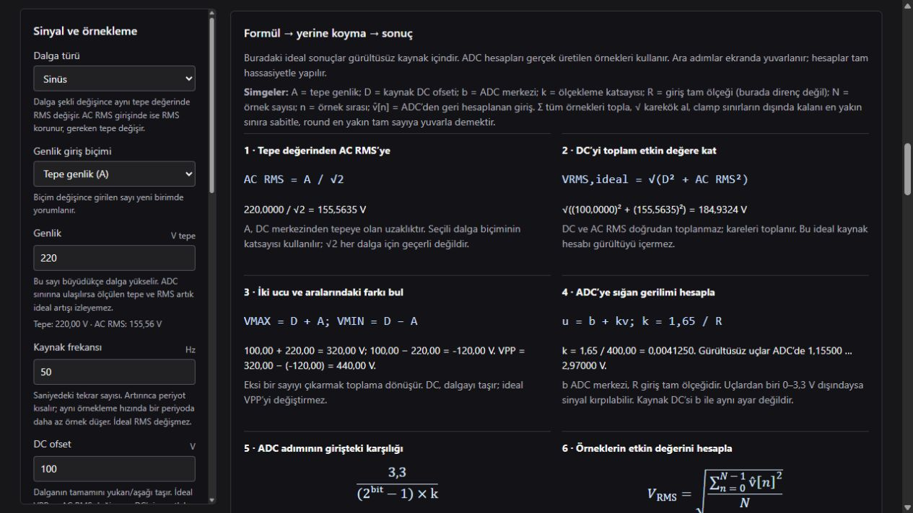

# AC Ölçüm Simülatörü

**Dalga biçiminden ADC örneğine, ölçüm sonucundan formülüne uzanan etkileşimli bir elektronik laboratuvarı.**

AC Ölçüm Simülatörü; sinyal üretimi, analog–sayısal dönüşüm ve temel gerilim ölçümlerini aynı ortamda incelemek için geliştirilmiş, Türkçe arayüzlü bir eğitim uygulamasıdır. Parametreleri değiştirerek ideal kaynak değerlerini, örneklenmiş sinyali ve ADC’den hesaplanan sonuçları karşılaştırabilirsiniz.

**Tarayıcıda çalışır · Çevrimdışı kullanılabilir · Kurulum gerektirmez · Harici uygulama kütüphanesi içermez**

[Hızlı başlangıç](#hızlı-başlangıç) · [Özellikler](#özellikler) · [Ölçüm modeli](#ölçüm-modeli) · [Deneyler](#hazır-deneyler) · [Kullanım kılavuzu](KULLANIM.md)

## Arayüz



*Her ayarın etkisini açıklayan metinler, sayısal değerlerle doldurulan formüller ve birlikte güncellenen ölçüm sonuçları.*

## Projenin amacı

Bir ölçüm sonucunu görmek kadar, o sonucun **nasıl oluştuğunu ve hangi koşullarda değiştiğini** anlamak da önemlidir. Bu proje şu soruları deneyerek incelemeyi sağlar:

- 220 V tepe ile 220 V RMS arasındaki fark nedir?
- DC ofset eklenince tepe değerleri, AC RMS ve toplam RMS nasıl değişir?
- ADC giriş aralığı aşılırsa hangi bilgiler kaybolur?
- Örnekleme hızı ve bit sayısı ölçümü farklı şekillerde nasıl etkiler?
- İdeal kaynak değeriyle ölçülen sonuç neden tam olarak aynı değildir?

Uygulama; elektronik öğrencileri, mikrodenetleyici ölçüm algoritmalarını öğrenen geliştiriciler ve uygulamalı anlatım hazırlayan eğitmenler için tasarlanmıştır.

## Hızlı başlangıç

### Doğrudan tarayıcıda açın

1. GitHub üzerindeki **Code → Download ZIP** seçeneğiyle projeyi indirin ve arşivi çıkarın.
2. `index.html` dosyasını güncel bir tarayıcıda açın.
3. Bir hazır deney seçin veya soldaki sinyal ve ADC ayarlarını değiştirin.

Uygulamayı çalıştırmak için Python, Node.js, paket kurulumu veya internet bağlantısı gerekmez.

### Git ile indirin

```sh
git clone https://github.com/elcrezoo/ac-olcum-simulatoru.git
cd ac-olcum-simulatoru
```

Ardından `index.html` dosyasını tarayıcınızda açın.

### İsteğe bağlı yerel sunucu

Python yüklüyse proje klasöründe aşağıdaki komutu çalıştırabilirsiniz:

```sh
python -m http.server 8000 --bind 127.0.0.1
```

Tarayıcıdan [localhost:8000](http://127.0.0.1:8000) adresini açın. Bu adım isteğe bağlıdır.

## Özellikler

| Alan | Sunulan işlevler |
| --- | --- |
| **Sinyal üretimi** | Sinüs, kare, üçgen ve testere; tepe veya AC RMS cinsinden genlik girişi |
| **Kaynak ayarları** | Frekans, DC ofset ve tekrarlanabilir, sınırlı gürültü |
| **ADC modeli** | 0–3,3 V dönüşümü; giriş ölçeği, merkez gerilimi, örnekleme hızı ve 8/10/12/16 bit çözünürlük |
| **Ölçüm çıktıları** | VMAX, VMIN, VPP, VDC, toplam RMS, AC RMS, frekans ve giriş LSB değeri |
| **Görselleştirme** | Kaynak dalgası, ADC örnekleri, ADC gerilim grafiği ve 20×4 sanal LCD |
| **Karşılaştırma** | Kaydedilen referans ile mevcut sonuçların önce/sonra ve fark tablosu |
| **Açıklamalı hesaplar** | Formül → sayıları yerine koyma → sonuç; seçili örneğin dönüşüm adımları |
| **Hata incelemesi** | İdeal kaynak → ADC öncesi örnekler → ADC ölçümü karşılaştırması |
| **Deneyler ve dışa aktarma** | On hazır deney, örnek tablosu ve tüm örnekleri içeren CSV çıktısı |

## İlk ölçümünüz

Başlangıç ayarları aşağıdaki deneyi oluşturur:

| Parametre | Değer |
| --- | --- |
| Dalga | Sinüs |
| Genlik | 220 V tepe |
| Frekans | 50 Hz |
| DC ofset / gürültü | 0 V / 0 V |
| Örnekleme | 10.000 örnek/s |
| Ölçüm penceresi | 0,2 s — 2.000 örnek |
| ADC | 12 bit, 0–3,3 V |
| Giriş ölçeği / ADC merkezi | ±400 V / 1,65 V |

Bu sinyalin ideal değerleri **VMAX = +220 V**, **VMIN = −220 V**, **VPP = 440 V** ve **VRMS ≈ 155,56 V** olur. ADC modelinde RMS yaklaşık **155,57 V** ölçülür; kuantalama nedeniyle küçük farklar beklenir.

**220 V RMS sinüs** üretmek için genlik giriş biçimini **AC RMS (DC hariç)** olarak değiştirin. Tepe değeri otomatik olarak yaklaşık **311,13 V** olur.

## Ölçüm modeli

```text
Sanal kaynak
    ↓
İdeal izolasyon ve ölçekleme
    ↓
ADC merkez geriliminin eklenmesi
    ↓
0–3,3 V sınırlandırma ve kuantalama
    ↓
Giriş voltuna geri dönüş
    ↓
Ölçüm hesapları → Grafikler · LCD · Karşılaştırmalar · CSV
```

### ADC dönüşümü

`R` giriş tam ölçeğini, `b` ADC merkez gerilimini, `B` bit sayısını ve `v[n]` kaynak örneğini temsil eder. Buradaki `R` bir direnç değeri değildir.

```text
k = 1,65 / R
u[n] = b + k × v[n]
Q = 2ᴮ − 1
kod[n] = round(clamp(u[n], 0, 3,3) / 3,3 × Q)
v̂[n] = (kod[n] × 3,3 / Q − b) / k
```

Bu modelde ADC uç noktaları eşlenir. `clamp`, aralık dışındaki gerilimi en yakın sınıra sabitler; `round`, en yakın tam sayı koduna yuvarlar. `v̂[n]`, ADC kodundan geri hesaplanan giriş gerilimidir.

### Örneklerden hesaplanan büyüklükler

`N`, ölçüm penceresindeki örnek sayısıdır. Toplamlar `n = 0 … N−1` aralığında alınır.

| Büyüklük | Hesap | Anlamı |
| --- | --- | --- |
| VMAX | `max(v̂[n])` | Ölçülen en büyük işaretli değer |
| VMIN | `min(v̂[n])` | Ölçülen en küçük işaretli değer |
| VPP | `VMAX − VMIN` | Tepeden tepeye gerilim |
| VDC | `Σv̂[n] / N` | İşaretli ortalama |
| VRMS | `√(Σv̂[n]² / N)` | DC dahil toplam etkin değer |
| AC RMS | `√(Σ(v̂[n] − VDC)² / N)` | Ortalama çıkarıldıktan sonraki etkin değer |
| Giriş LSB | `3,3 / (Q × k)` | Bir ADC koduna karşılık gelen giriş gerilimi |

AC RMS doğrudan ortalamadan sapmalar üzerinden hesaplanır. Böylece büyük DC yanında küçük AC bulunurken iki büyük kareyi çıkarmanın yol açabileceği sayısal hassasiyet kaybı azaltılır.

Frekans, ADC örneklerinin ortalama çevresindeki yükselen geçişlerinden; histerezis, doğrusal enterpolasyon ve periyot aralıklarının medyanı kullanılarak tahmin edilir. **Kaynak frekansı LCD’ye doğrudan kopyalanmaz.** Yeterli veya uygun geçiş bulunamadığında sonuç gösterilmez.

### Tepe ve RMS ilişkisi

Aşağıdaki ilişkiler **gürültüsüz, sıfır DC’li ve tam periyot üzerinden değerlendirilen** ideal dalgalar içindir. `A`, tepe genliktir.

| Dalga | RMS | RMS’den tepeye dönüşüm |
| --- | --- | --- |
| Sinüs | `A / √2` | `A = RMS × √2` |
| Kare, %50 görev oranı | `A` | `A = RMS` |
| Simetrik üçgen | `A / √3` | `A = RMS × √3` |
| Simetrik testere | `A / √3` | `A = RMS × √3` |

Bu dalgalara `D` kadar DC ofset eklendiğinde:

```text
VMAX = D + A
VMIN = D − A
VPP = 2A
VRMS,toplam = √(D² + VAC,RMS²)
```

**VMAX = VRMS × √2** ilişkisi yalnızca DC ofsetsiz saf sinüs için doğrudan kullanılabilir. Gürültü, farklı dalga biçimi veya DC ofset varsa bu ilişkiyi genel bir dönüşüm olarak kullanmayın.

## Hazır deneyler

Her deney kendi referans ayarlarını yükler ve açıklanan değişikliği uygular. Sonrasında parametreleri değiştirerek deneyi sürdürebilirsiniz.

| Deney | İncelenen etki |
| --- | --- |
| 220 V tepe → 220 V RMS | Genlik biriminin tepeye ve etkin değere etkisi |
| Genliği iki katına çıkar | Kırpılmasız durumda gerilimlerin ölçeklenmesi |
| 100 V DC ofset ekle | Toplam RMS ile AC RMS arasındaki fark |
| Sinüs → kare, aynı tepe | Dalga biçiminin etkin değere etkisi |
| ADC kırpılmasını gör | Giriş aralığı dışında kaybolan bilgi |
| Yetersiz örneklemeyi gör | Örtüşme ve geçersiz frekans tahmini |
| 12 bit → 8 bit | Kuantalama adımının büyümesi |
| Ölçeği büyüt | Ölçüm aralığı ile voltaj çözünürlüğü arasındaki ilişki |
| Tam periyot olmayan pencere | Pencere seçiminin ortalama ve RMS’ye etkisi |
| Gürültüyü ekle | İdeal, örneklenmiş ve sayısallaştırılmış sonuçların ayrışması |

Kendi deneyiniz için **Mevcut ayarları referans al** düğmesini kullanın. Bir parametreyi değiştirip **Önce / sonra**, **Sayılı formüller** ve **Hata nereden geliyor?** bölümlerini birlikte inceleyin.

## Doğrulama

Sayısal testler Node.js ile, ek paket yüklemeden çalıştırılır:

```sh
node tests/measurements.cjs
```

Test kapsamı:

- Dört dalga türünde RMS ve frekans hesapları.
- Tepe/AC RMS giriş dönüşümü ve DC ofsetli toplam RMS.
- ADC kırpılması, düşük örnekleme ve kısa ölçüm penceresi.
- Sabit DC’de AC bileşeni ve RMS ayrışımı.
- Gürültünün tekrarlanabilirliği ve 200.000 örneklik üst sınır.
- Hazır deneyler, pencere ortalaması ve ADC adımı.

Bu testler sayısal modeli doğrular; fiziksel donanım doğrulaması veya bir ölçüm doğruluğu sertifikası değildir.

## Kapsam ve sınırlamalar

- **Soyut eğitim modeli:** Fiziksel devre, bileşen seçimi veya şebeke bağlantı şeması içermez. İzolasyon bloğu matematiksel bir varsayımdır.
- **İdeal ADC yaklaşımı:** Gerçek ADC'nin referans, kazanç, ofset, doğrusal olmama ve zamanlama hatalarının tamamı modellenmez.
- **Örtüşme önleyici filtre yoktur:** Temel frekansın uygun örneklenmesi, tüm harmoniklerin ve gürültünün de uygun örneklendiği anlamına gelmez.
- **Gürültü sınırlı ve tekrarlanabilirdir:** Beyaz Gauss gürültüsü değildir; girilen sınır bir RMS değeri değildir.
- **Sonlu pencere kullanılır:** Tam periyot içermeyen kayıtlar, tepeyi kaçıran örnek zamanları ve gürültü sonuçları etkileyebilir.
- **Grafikler seyreltilir:** Yoğun görünümde en fazla 1.200 ADC noktası çizilir. Hesaplar ve CSV çıktısı tüm örnekleri içerir.
- **Frekans tahmini koşulludur:** Gürültü ve harmonikler geçiş tabanlı yöntemi yanıltabilir; sonuç bir güven aralığı sunmaz.

## Proje yapısı

```text
ac-olcum-simulatoru/
├── index.html                 # Tek dosyalı uygulama
├── README.md                  # Proje tanıtımı ve hızlı başlangıç
├── KULLANIM.md                # Ayrıntılı Türkçe kullanım kılavuzu
├── docs/
│   └── onizleme.png           # Arayüz görüntüsü
└── tests/
    └── measurements.cjs      # Sayısal model testleri
```

Uygulama HTML, CSS ve JavaScript ile geliştirilmiştir. Grafikler Canvas, seçili matematiksel ifadeler MathML ile gösterilir. Uygulama için derleme veya paket yöneticisi adımı bulunmaz; Node.js yalnızca testleri çalıştırmak için kullanılır.

## Geri bildirim

Hata bildirimi veya geliştirme önerisi için [Issues](https://github.com/elcrezoo/ac-olcum-simulatoru/issues) bölümünü kullanabilirsiniz. Ölçümle ilgili bir bildirimde dalga türünü, sinyal ve ADC ayarlarını, beklenen sonucu ve gördüğünüz çıktıyı paylaşmanız sorunun tekrar oluşturulmasını kolaylaştırır.
